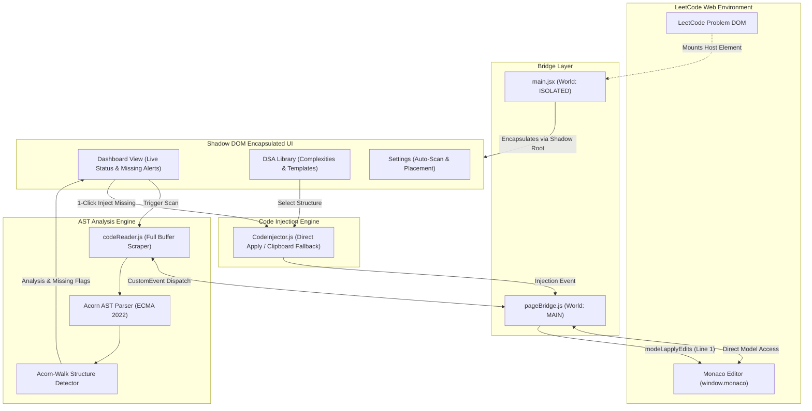

# JS DSA - LeetCode JavaScript Toolkit 🚀

[](https://developer.chrome.com/docs/extensions/mv3/intro/)
[](https://react.dev/)
[](https://tailwindcss.com/)
[](https://vitejs.dev/)
[](LICENSE)

A developer-focused browser extension (Manifest V3) that provides a comprehensive JavaScript Data Structures & Algorithms (DSA) toolkit directly inside **LeetCode**.

Unlike C++, Java, or Python, JavaScript natively lacks built-in standard interview data structures like an $O(1)$ Queue, Priority Queue / MinHeap, Trie, and Union-Find. **JS DSA** analyzes your JavaScript solution in real time, detects instantiated structures, flags missing definitions, and enables 1-click injection of optimal, interview-tested implementations directly into LeetCode's Monaco editor.

---

## 🏗️ Architecture & Workflow

The extension operates with strict CSS and execution context isolation, ensuring zero interference with LeetCode's interface while maintaining direct programmatic access to the underlying Monaco editor buffer.



---

## ✨ Key Features

- 🔍 **Real-Time AST Solution Scanning**: Parses code directly from the Monaco editor model using `acorn` and `acorn-walk`, bypassing DOM virtualization limits.
- ⚠️ **Missing Structure Detection**: Detects instantiated classes (e.g., `new Queue()`, `new MinHeap()`, `new Trie()`). If the class definition is missing from your solution, it flags it with an instant **"Inject Definition"** action.
- ⚡ **Direct Monaco Injection**: Injects boilerplate directly at Line 1 (or at cursor position) via the Monaco Model API without corrupting your undo/redo history.
- 🛡️ **Shadow DOM Encapsulation**: Mounts inside a native `shadowRoot` with reset preflight rules, guaranteeing LeetCode's dark mode and global CSS cannot override or distort the extension interface.
- 📦 **Optimal DSA Library**: Searchable catalog with complexity matrices, usage examples, and 1-click injection.
- ⚙️ **Customizable Preferences**: Configure auto-scan triggers and injection placement (Top of file vs. At cursor).

---

## 📊 Supported Data Structures Matrix

| Structure | Best For | Key Operations | Time Complexity | Space |
| :--- | :--- | :--- | :--- | :--- |
| **Queue** | BFS, sliding windows | `enqueue()`, `dequeue()`, `peek()` | $O(1)$ amortized | $O(N)$ |
| **Deque** | Sliding window maximum, monotonic queues | `pushFront()`, `popBack()`, `peekFront()` | $O(1)$ | $O(N)$ |
| **MinHeap / MaxHeap** | Top-K elements, Dijkstra, interval scheduling | `push()`, `pop()`, `peek()` | $O(\log N)$ push/pop | $O(N)$ |
| **Trie** | Prefix searching, autocomplete, word dictionaries | `insert()`, `search()`, `startsWith()` | $O(L)$ word length | $O(N \cdot L \cdot \Sigma)$ |
| **Union-Find (DSU)** | Dynamic connectivity, Kruskal's MST, cycles | `find()`, `union()`, `connected()` | $\alpha(N) \approx O(1)$ | $O(N)$ |
| **Segment Tree** | Mutable range sum, range minimum queries (RMQ) | `query(l, r)`, `update(idx, val)` | $O(\log N)$ query/update | $O(N)$ |
| **Binary Search** | First/last position in sorted sequences | `lowerBound()`, `upperBound()` | $O(\log N)$ | $O(1)$ |
| **Helpers** | Rapid local test cases & tree visualizers | `ListNode.fromArray()`, `TreeNode.fromArray()` | $O(N)$ | $O(N)$ |

---

## 🚀 Quickstart & Installation

### Option 1: Run from Source (Developer Mode)

1. **Clone and build**:
   ```bash
   git clone https://github.com/KJayadeep/dsa-js-extension.git
   cd dsa-js-extension/extension
   npm install
   npm run build
   ```

2. **Load into Browser**:
   * Navigate to `chrome://extensions/` (or `edge://extensions/`, `brave://extensions/`).
   * Enable **Developer mode** (top-right toggle).
   * Click **Load unpacked** and select the `/extension/dist` directory.

3. **Use on LeetCode**:
   * Open any [LeetCode Problem](https://leetcode.com/problems/two-sum/).
   * Click the floating **JS DSA** button in the bottom-right corner.

---

### Option 2: Pre-Packaged Release

1. Download `js-dsa-extension.zip` from the latest [GitHub Release](https://github.com/KJayadeep/dsa-js-extension/releases).
2. Unzip the file to a local folder.
3. In `chrome://extensions/`, enable **Developer mode** and load the unzipped folder using **Load unpacked**.

---

## 🛠️ Technology Stack

* **Runtime**: Chrome Manifest V3
* **Bundler & Tooling**: Vite 8, `@crxjs/vite-plugin`
* **UI & Styling**: React 19, Tailwind CSS v4, Lucide Icons
* **Static Analysis**: `acorn` (AST Parser), `acorn-walk` (AST Visitor)
* **Editor Target**: Monaco Editor (VS Code core)

---

## 📄 License

This project is licensed under the [MIT License](LICENSE).
